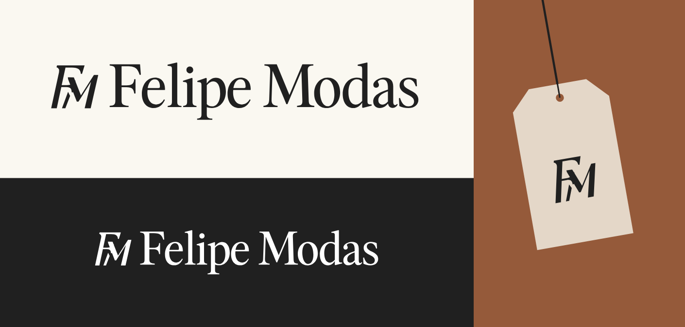

# Felipe Modas

## A escolha do desenho

Estudos da esquerda para a direita.

| Estudo | Construção | Leitura |
|---|---|---|
| Folha de tecido | Duas curvas longas sugerem o movimento de uma peça. | Expressivo em etiquetas grandes. A associação com as iniciais fica distante. |
| Fio contínuo | Um traço une as hastes de F e M. | Funciona como ilustração linear, mas o cruzamento perde definição em tamanho pequeno. |
| Dobra FM | A barra média do F encontra a diagonal do M. Uma abertura no pé mantém as letras distintas. | Escolhido pela leitura das iniciais e pela silhueta inclinada que lembra uma dobra. |

A marca é composta no Canvas 2D com letras desenhadas individualmente. O F abre a assinatura com uma serifa longa. A caixa baixa e as curvas amplas de “Modas” equilibram a inclinação do símbolo. A matriz local permite escolher a composição, ajustar a cor e definir a largura em pixels. A assinatura não depende de instalação de fonte.

## Assinaturas e aplicações

| Arquivo em `assets/brand/` | Uso | Largura mínima sugerida |
|---|---|---:|
| `logo.png` | Cabeçalho e peças horizontais | 150 px |
| `wordmark.png` | Nome sem símbolo, quando o monograma já aparece ao lado | 126 px |
| `compact.png` | Etiqueta, verso de embalagem e peças verticais | 110 px |
| `monogram.png` | Assinatura secundária ou avatar | 24 px |
| `favicon.png` | Abas e atalhos de navegador | 16 px |
| `apple-touch-icon.png` | Ícone de tela inicial | 180 × 180 px |

As quatro assinaturas têm versões carvão, branca (`-light`) e preta (`-mono`). As assinaturas são entregues em PNG transparente em alta resolução. Para uma nova dimensão, abra `assets/brand/atelier-canvas.html`, selecione a peça, escolha a cor e a largura e use **Exportar PNG**. A interface funciona offline. O ícone de tela inicial já incorpora o fundo carvão.

Deixe espaço equivalente a metade da altura do F em todas as bordas da assinatura. Para o monograma sozinho, reserve um quarto da altura do próprio símbolo. Use a versão branca sobre fundos escuros uniformes e a carvão em branco ou marfim. Sobre fotografia, posicione a assinatura numa área contínua com contraste estável em todos os recortes. Preserve as proporções ao redimensionar.

## Paleta

| Tom | Valor | Aplicação |
|---|---|---|
| Carvão | `#202020` | Texto, assinatura e elementos de maior contraste |
| Branco | `#FFFFFF` | Áreas de leitura e fotografia |
| Marfim | `#FAF8F1` | Fundo alternativo de campanha e editorial |
| Areia | `#D9C8B7` | Separadores decorativos e acabamento |
| Terracota | `#955A3A` | Chamada comercial e botões com texto branco |

Texto branco sobre terracota tem contraste de 5,52:1. Carvão sobre marfim chega a 15,33:1. A areia sobre branco tem contraste de 1,63:1. Reserve-a para detalhes decorativos e use tom mais escuro nas bordas de controles que precisam indicar estado.

## Fotografia e composição

Na vitrine, mantenha o mesmo eixo vertical, preserve a peça inteira quando possível e dê à modelagem espaço dentro do quadro. Para campanha, articule enquadramentos abertos com recortes de tecido; em cada slide o texto deve ocupar uma área calma da imagem. O desktop deve ser recomposto para o formato vertical do celular. Mantenha a mensagem, seu contraste e o acesso à categoria em ambos.

## Referência visual revisitada em 24 de novembro de 2026

A home da Artsy usa fotografia em toda a largura, navegação sobre a campanha e uma chamada curta. Em 390 × 844 px no Safari, o recorte passa a ser vertical e a marca ocupa o centro do cabeçalho. A escolha para a Felipe Modas é reservar uma área livre em cada foto para escrever as chamadas em HTML e planejar o recorte vertical de cada campanha. [Home da Artsy](https://artsy.com.br/)

Na coleção de vestidos, os atalhos por tamanho aparecem antes dos comandos de filtro e ordenação. A página do Vestido Cecília articula a galeria à esquerda e o painel de compra à direita no desktop. No celular, a galeria antecede nome e preço, seguida de tamanho, quantidade, adição à sacola, CEP e detalhes. A direção da Felipe Modas preserva essa sequência e usa os atributos próprios de cada peça. [Coleção de vestidos](https://artsy.com.br/collections/vestidos) · [Vestido Cecília](https://artsy.com.br/products/vestido-cecilia-1)

## Tipografia

A assinatura utiliza lettering original. Cada palavra e o símbolo são compostos na matriz Canvas e exportados em PNG. A assinatura pode ser usada pela Felipe Modas independentemente de licença de fonte.

A hierarquia editorial combina uma serifada de contraste moderado para os títulos de campanha com uma sem serifa de tela para navegação, nomes de produtos, descrições, preços e formulários. Defina as duas famílias no tema, pelas variáveis `--font-display` e `--font-body`. Georgia e a família sem serifa de sistema são alternativas locais que dispensam o envio de arquivos tipográficos ao navegador. Os arquivos de fonte de sistema permanecem sob a licença da plataforma da visitante.

Em títulos de campanha, preserve as terminações da serifada, mantenha o entrelinhamento próximo ao corpo e confira as quebras de palavras no formato vertical. Use numerais claros nos preços, texto corrido alinhado à esquerda e um tamanho mínimo de 16 px nos campos de entrada.
